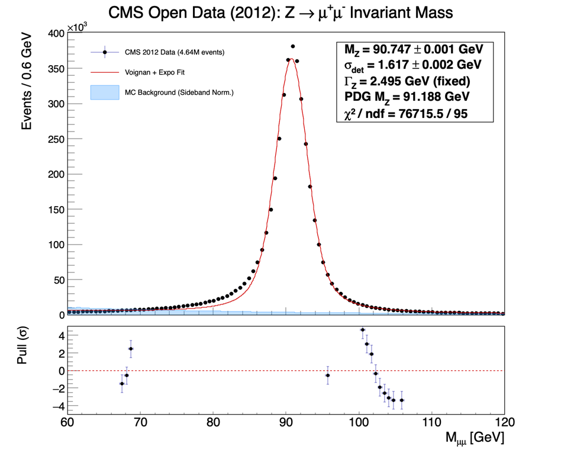

# Road to CERN

This repository is my personal learning path in experimental particle physics. It starts with the basics of the CERN ROOT framework and ends with a real physics analysis on public data from the CMS experiment at the Large Hadron Collider (LHC).

The main goal is simple: learn the tools that physicists at CERN use every day, and then apply them to real collision data.



## What Is Inside?

The project has two main parts:

| Folder | Description |
|---|---|
| `root_primer_practice/` | Short practice scripts that teach the core ROOT concepts step by step, using synthetic (simulated) data. |
| `cern-dimuon-analysis/` | A complete analysis pipeline that finds the Z boson in real CMS Open Data from 2012 and measures its mass. |

## Part 1: ROOT Primer Practice

These scripts follow a logical order. Each one builds on the ideas from the previous script.

| Script | Topic |
|---|---|
| `00_tree_scalar_branches.py` | Creating a `TTree` with simple scalar branches and filling it with random collision events (`TRandom3`). |
| `01-histograms-and-graphs.py` | Basic histograms and graphs. |
| `02-tfile-read-write-ttree.py` | Writing objects to a `.root` file with `TFile` and reading them back. |
| `03-tbranch.py` | Building branches with memory buffers, then reading single events with random access. |
| `04-th1f-th2f.py` | Filling `TH1F` histograms from a tree, drawing them and normalizing them. |
| `05-cuts-selections.py` | Event selection for Z → μ⁺μ⁻: transverse momentum cuts and opposite charge requirements. |
| `06-rdataframe-statistical-fitting-pyroot-numpy-bridge.py` | A synthetic Z boson sample, `RDataFrame`, statistical fitting and the bridge between PyROOT and NumPy. |

Some example plots produced by these scripts (`pt_distribution.png`, `cuts_comparison.png`, `z_boson_fit.png` and others) are stored in the same folder.

## Part 2: CMS Dimuon Analysis

This is the main project of the repository. It reconstructs Z bosons that decay into two muons (Z → μ⁺μ⁻) using real proton proton collision data recorded by the CMS detector in 2012 at a centre of mass energy of 8 TeV.

### How It Works

1. **Data streaming:** The data file is read directly from the CERN Open Data portal (`eospublic.cern.ch`) with the XRootD protocol. Nothing needs to be downloaded first.
2. **Event selection:** Each event must pass four cuts:
   * exactly two muons (`nMuon == 2`)
   * opposite electric charges
   * transverse momentum above 25 GeV for both muons
   * pseudorapidity `|η| < 2.4` for both muons (central detector region)
3. **Invariant mass:** The mass of the muon pair is calculated from pT, η and φ of both muons, and filled into a histogram with 100 bins between 60 and 120 GeV.
4. **Background model:** An exponential background is generated with Monte Carlo sampling (inverse transform method) and scaled to the real data using two signal free sideband regions: 60 to 75 GeV and 105 to 120 GeV.
5. **Fit:** A combined model (relativistic Breit Wigner for the signal plus an exponential for the background) is fitted to the data with Minuit2. The Z boson mass and width are extracted, and a pull plot shows how well the model describes each bin.

About **4.64 million** dimuon events pass the selection in the 60 to 120 GeV window.

### Results

| Quantity | Value |
|---|---|
| Fitted Z mass (M_Z) | 90.727 ± 0.001 GeV |
| Fitted Z width (Γ_Z) | 4.212 ± 0.003 GeV |
| PDG reference mass | 91.188 GeV |

The fitted mass is close to the official value. The fitted width is larger than the natural width of the Z boson (about 2.5 GeV) because the simple model does not include the detector resolution. The high χ²/ndf value also shows that the model can be improved, for example by using a Voigtian function (Breit Wigner convolved with a Gaussian). This is a planned next step.

### Code Structure

```text
cern-dimuon-analysis/
├── algorithms/          # Plain text, step by step explanation of each module
│   ├── data_loader.txt
│   ├── mc_background.txt
│   └── fit_analysis.txt
├── src/
│   ├── data_loader.py   # RDataFrame + XRootD, event cuts, invariant mass histogram
│   ├── mc_background.py # Monte Carlo background and sideband normalization
│   └── fit_analysis.py  # Joint fit, pull calculation and final plot
├── outputs/             # Generated plots
├── requirements.txt
└── README.md
```

The `algorithms/` folder is useful if you want to understand the logic before reading the code.

## Installation

ROOT is installed through Conda (from the conda forge channel), not through pip.

### Option A: Use the provided environment file

```bash
conda env create --file environment.yml
conda activate cern-env
```

Note: `environment.yml` was exported on macOS with Apple Silicon. On Linux or Windows (WSL), Option B is usually easier.

### Option B: Create a minimal environment

```bash
conda create --name cern-env python=3.11 root numpy xrootd --channel conda-forge
conda activate cern-env
```

## Usage

Clone the repository:

```bash
git clone https://github.com/ahmetbinomer/road-to-cern.git
cd road-to-cern
```

Run a primer script:

```bash
cd root_primer_practice
python 00_tree_scalar_branches.py
```

Run the full Z boson analysis:

```bash
cd cern-dimuon-analysis/src
python fit_analysis.py
```

This command streams the data, applies the cuts, builds the background, runs the fit and saves the final plot to `outputs/z_boson_fit.png`. You need a working internet connection, and the first run can take several minutes because tens of millions of events are processed. The analysis uses all available CPU cores automatically.

To produce only the raw mass spectrum:

```bash
python data_loader.py
```

## Tech Stack

* **Python 3.11**
* **CERN ROOT / PyROOT:** `TTree`, `TFile`, `TH1`, `TF1`, `RDataFrame`, `TRandom3`, Minuit2
* **XRootD:** remote data access
* **NumPy**
* **Conda** (conda forge)

## Data Source

CMS collaboration, *DoubleMuParked dataset, Run2012B and Run2012C*, reduced NanoAOD format, available on the [CERN Open Data Portal](https://opendata.cern.ch/). The data is used here for educational purposes only.

## Roadmap

* Add detector resolution to the signal model (Voigtian fit)
* Use official CMS Monte Carlo samples instead of a synthetic background
* Study other resonances in the dimuon spectrum (J/ψ, Υ)
* Add Jupyter notebooks with explanations

## Author

**Ahmet** ([@ahmetbinomer](https://github.com/ahmetbinomer))

Feel free to open an issue if you have questions or suggestions.
